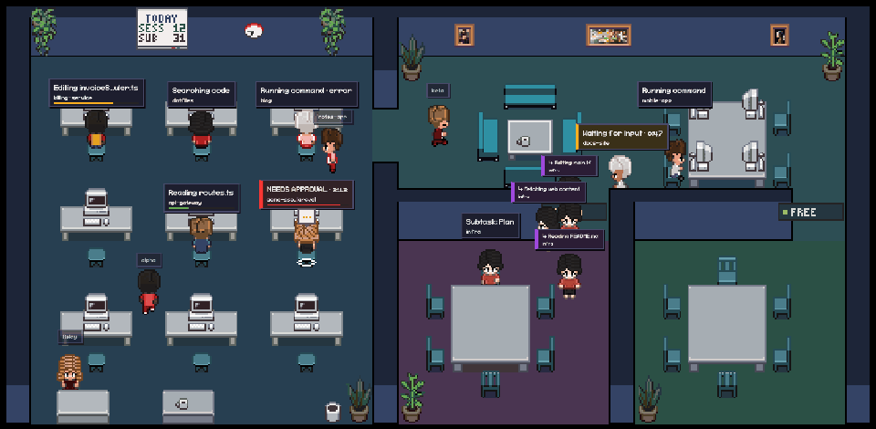
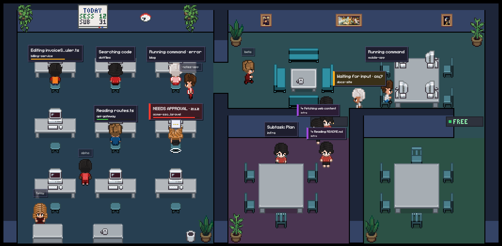
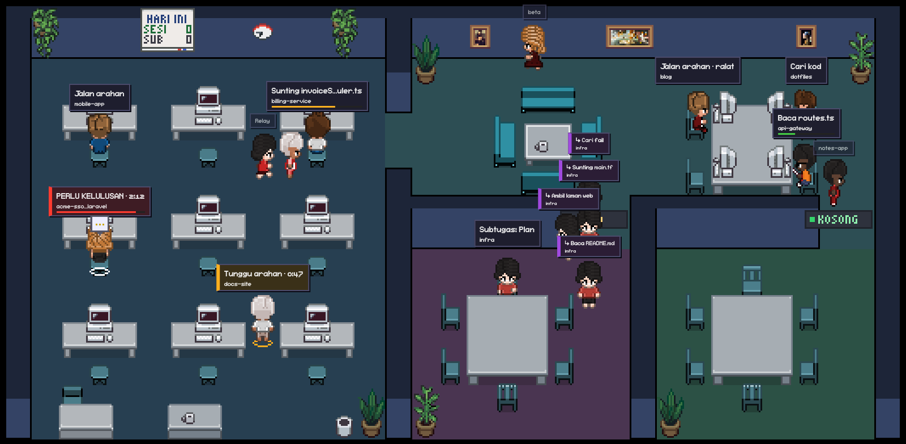
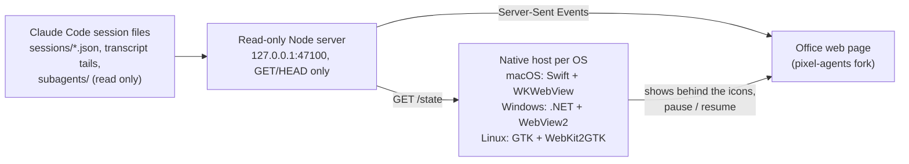

# Quiet Office

**Your Claude Code sessions, alive on your desktop: a pixel-art office wallpaper that only watches, never touches.**

[](https://github.com/imanhamka/quiet-office/actions/workflows/ci.yml)
[](LICENSE)




Each Claude Code session is a character at a desk. Sub-agents walk in, work in team rooms and leave.
A red PC and a ring mark the one that waits for you.

Unofficial. Not affiliated with Anthropic or pixel-agents.

## Contents

- [Why I built this](#why-i-built-this)
- [Features](#features)
- [How it differs](#how-it-differs)
- [Quick start](#quick-start)
- [How it works](#how-it-works)
- [Config](#config)
- [Measured cost](#measured-cost)
- [Privacy and security](#privacy-and-security)
- [Known limits](#known-limits)
- [FAQ](#faq)
- [Contributing](#contributing)
- [Credits](#credits)

## Why I built this

I run many Claude Code sessions at once and kept missing the one waiting on a permission.
I wanted to see it at a glance on the desktop I already look at, without giving a tool write access to my agents.

## Features

- **Who needs you:** a red PC and a ring for permission waits. The menu bar or tray lists waiting agents, oldest first. An optional notification fires after 2 minutes.
- **Sub-agents:** they walk in to their own desks, then move to team rooms with door signs that name the lead.
- **Office life:** idle agents go to the lounge. Everyone stretches when all work is done. A whiteboard sums up the day.
- **Real time:** a wall clock and day/night lighting follow your local time.
- **Reception:** a chat-relay agent (Claude Code channel plugins) sits at the front desk. An envelope appears for each new channel message. No message text is read out.
- **Today stats:** sessions and sub-tasks started today, in the menu and on the whiteboard.
- **Privacy mode:** hides every name and label. It turns on by itself during a Zoom screen share.
- **Two languages:** English and Bahasa Melayu, in the page and in the menus.

| English | Bahasa Melayu |
|---|---|
|  |  |

## How it differs

Other pixel offices for Claude Code exist. Quiet Office makes different trade-offs.

| Project | Where it shows | How it gets data | Can act on agents |
|---|---|---|---|
| **Quiet Office** | Your desktop wallpaper, behind the icons | Reads session files. No hooks. | No. Never approves, never writes. |
| [pixel-agents](https://github.com/pixel-agents-hq/pixel-agents) | VS Code panel or browser | Installs Claude Code hooks | Launches agents in terminals |
| [Claude-Office](https://github.com/W17ant/Claude-Office) | Local web app | Claude Code hooks and status line | Allow/Deny card can approve tools |
| [bagidea-office](https://github.com/bagidea/bagidea-office) | Godot app on the wallpaper | Runs its own agents | Yes, with your model API keys |
| [agent-office](https://github.com/alminisl/agent-office) | Browser tab | Reads session data | Starts sessions and background agents. No licence published. |

What Quiet Office adds:

- **Read-only by design:** a GET-only server on `127.0.0.1` with a Host check, zero npm dependencies.
- **Measured cost:** at most 5% of one core when visible on an Intel Mac, about 1% when hidden.
- **Privacy built in:** prompts and command text never leave the server. Privacy mode turns on by itself during a Zoom screen share.
- **Tells you who needs you:** red PC, ring, menu list, optional notification.

## Quick start

You need [Claude Code](https://code.claude.com/), Node.js 22 or later, and git.

### macOS (stable)

Needs macOS 13 or later and the Xcode Command Line Tools (`xcode-select --install`).

```sh
git clone https://github.com/imanhamka/quiet-office.git
cd quiet-office
scripts/macos/build.sh
scripts/macos/install.sh
```

The menu bar item appears. Remove it with `scripts/macos/uninstall.sh`.

### Windows (experimental)

Built in CI, not yet tested on real hardware. Needs the .NET 10 SDK and the WebView2 Runtime (included in Windows 11).

```powershell
git clone https://github.com/imanhamka/quiet-office.git
cd quiet-office
cd web\pixel-agents; npm ci --ignore-scripts; npm run build; cd ..\..
powershell -ExecutionPolicy Bypass -File scripts\windows\install.ps1
```

- The script publishes the host, adds an HKCU `Run` value so it starts at login, then starts it. The host starts and supervises the server.
- `-NoStart` installs without starting. Remove it with `scripts\windows\uninstall.ps1`.

- Windows 11 24H2 changed the desktop layer the host draws on. Please report what you see.
- Sessions inside WSL are not visible to a server that runs on the Windows side.

### Linux (experimental)

Works on X11 and on wlroots or KDE Wayland (layer-shell). GNOME Wayland is not supported.

```sh
git clone https://github.com/imanhamka/quiet-office.git
cd quiet-office
(cd web/pixel-agents && npm ci --ignore-scripts && npm run build)
scripts/linux/install.sh
```

- The script checks for Python 3, GTK 3 and WebKitGTK 4.1, plus optional GtkLayerShell, AyatanaAppIndicator and Wnck. It prints the package names for your distro. It never runs a package manager or `sudo`.
- It installs a systemd user unit for the server and an XDG autostart entry for the host. The host starts at the next login.
- `scripts/linux/install.sh --no-start` enables both without starting the server.
- NVIDIA proprietary driver and a blank wallpaper: set `WEBKIT_DISABLE_DMABUF_RENDERER=1`.
- Remove it with `scripts/linux/uninstall.sh`.

### Try it in a browser first

```sh
cd web/pixel-agents && npm ci --ignore-scripts && npm run build && cd ../..
node server/server.mjs
```

Open <http://127.0.0.1:47100/?wallpaper=1&demo=1> for fixture agents, or drop `demo=1` for your live sessions.

## How it works



1. The server polls the Claude config directory every 750 ms. It reads, never writes.
2. It turns session state into small messages: name, mode, tool verb + file basename, counts.
3. The page draws the office from those messages.
4. The host puts the page behind your desktop icons and pauses it when you cannot see it.

More: [architecture](docs/architecture.md) · [data contract](docs/data-contract.md) · [adding a host](docs/adding-a-host.md)

## Config

Optional. Missing or invalid means defaults. Nothing writes it.

- macOS, Linux: `${XDG_CONFIG_HOME:-~/.config}/quiet-office/config.json`
- Windows: `%APPDATA%\quiet-office\config.json`

```json
{
  "lang": "auto",
  "aliases": { "my-repo-dir": "Nice Name" },
  "reception": { "agent": null, "channels": [] },
  "privacy": { "default": false, "autoProcesses": ["CptHost"] },
  "contextMax": 200000
}
```

| Key | Meaning |
|---|---|
| `lang` | `auto`, `en` or `ms`. |
| `aliases` | Rename agents for display. |
| `reception.agent` | Display name of the agent at the reception desk. `null` leaves it empty. |
| `reception.channels` | Channel plugin server names that trigger the envelope. `[]` means any. |
| `privacy.default` | Start in privacy mode. |
| `privacy.autoProcesses` | Process names that turn privacy mode on while they run. |
| `contextMax` | Context window size for the context bar. |

All keys and environment variables: [docs/config.md](docs/config.md).

## Measured cost

Intel Mac (Core i9, Radeon 5700 XT), one 1600×900 pt display. Host + WebKit + server, as a share of one core.

| State | CPU |
|---|---|
| Visible, frame skipping on | 4.08–4.75% |
| Covered (≥ 90%), locked or display asleep | about 1% or less |

How: 12 fps while anyone walks, 10 otherwise, identical frames skipped, paused when hidden.
Windows and Linux are not measured yet. Details: [docs/performance.md](docs/performance.md).

## Privacy and security

- **Reads:** session JSON files, transcript tails (at most 256 KB on the first read), sub-agent metadata, `config.json`, file timestamps, and process names for screen-share detection.
- **Sends to the page:** agent name, mode, tool verb + file basename, sub-agent type, error booleans, token counts, today counts.
- **Never sends:** command text, file contents, prompts, task descriptions, message text or senders.
- **Never does:** install hooks, write under the Claude config directory, change settings, approve tools, send input, connect beyond `127.0.0.1`, collect telemetry.
- **Writes:** its own host settings, logs and a lock file.
- **Server:** binds `127.0.0.1`, GET/HEAD only, rejects unknown `Host` headers, no CORS.

Full list: [docs/privacy.md](docs/privacy.md). Report a vulnerability: [SECURITY.md](SECURITY.md).

## Known limits

- **Undocumented input.** The server reads Claude Code's internal session registry (`~/.claude/sessions`), last checked against Claude Code 2.1.332. A Claude Code update can break it.
- **macOS private API.** The macOS host uses private WebKit selectors. A macOS update can break them.
- **No loopback auth.** Any local process can read `/state` and `/events`.
- **Names on screen.** The default view shows agent names and file basenames. Use privacy mode when others can see your screen.
- **Names in logs and notifications.** Logs contain agent names. Notifications show agent names; they are off by default and silent in privacy mode.
- **Desks.** The default layout has 6 desks. Extra agents stand or wander.
- **Windows and Linux** are experimental. See [Quick start](#quick-start).

## FAQ

**Can it approve a permission for me?**
No. It has no way to send input to a session. You still approve in Claude Code.

**Does it need an API key or network access?**
No. It reads local files and serves one page on `127.0.0.1`.

**Does it install Claude Code hooks or change my settings?**
No. Nothing is written under the Claude config directory.

**What happens when I rename a session?**
The character leaves and comes back under the new name. Names taken from the folder or tmux change only when you edit `aliases`.

**It uses a custom Claude config directory.**
Set `CLAUDE_CONFIG_DIR` for the server, the same way you set it for Claude Code.

**Can I see it without installing the host?**
Yes. See [Try it in a browser first](#try-it-in-a-browser-first).

**Does it work with other agents?**
Not yet. The server reads Claude Code's files only.

**Is Bahasa Melayu complete?**
Yes. Every page and menu string has an English and a Bahasa Melayu version. `lang` in `config.json` overrides the system language.

## Contributing

Bug reports, host testing on Windows and Linux, and translations are welcome.
Read [CONTRIBUTING.md](CONTRIBUTING.md) and the [Code of Conduct](CODE_OF_CONDUCT.md).
Redact agent names and paths before you paste logs or `/state` output.

## Credits

- [pixel-agents](https://github.com/pixel-agents-hq/pixel-agents) by Pablo De Lucca (MIT): the office engine and art this project forks.
- [MetroCity](https://jik-a-4.itch.io/metrocity-free-topdown-character-pack) characters by JIK-A-4 (CC0 1.0).
- Furniture, floors and walls from [pixel-agents PR #117](https://github.com/pixel-agents-hq/pixel-agents/pull/117) (MIT).
- The macOS host's window and WebKit setup is adapted from [Agent City](https://github.com/lucacadalora/agent-city) by Luca Cada Lora (MIT).

Full notices: [THIRD_PARTY_NOTICES.md](THIRD_PARTY_NOTICES.md).

### Built with Claude Code

Quiet Office was built with Claude Code. Each change started as a written contract ([docs/data-contract.md](docs/data-contract.md)).
Parallel agents then built the server, the page and each host against that contract.

## License

[MIT](LICENSE). Third-party parts keep their own licences.
