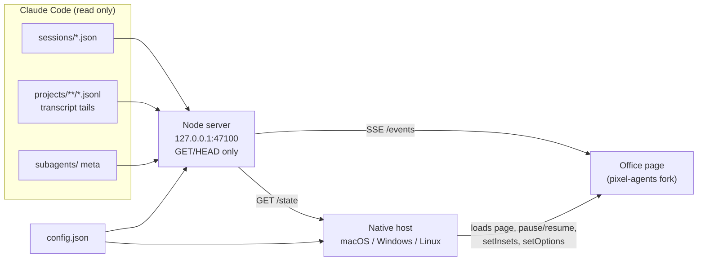

# Architecture

Quiet Office has three parts. Each part does one job.

## Server (`server/`)

- Zero-dependency Node, version 22 or later.
- Polls the Claude config directory every 750 ms, read only.
- Reads session files, the tail of each transcript and sub-agent metadata.
- Turns them into pixel-agents messages and streams them over Server-Sent Events.
- Serves the built page from `web/dist/`.
- Serves `GET /state` for the host menus.

| Module | Job |
|---|---|
| `server/server.mjs` | Entry point: env, config, start. |
| `server/lib/tracker.mjs` | Session discovery, agent state, tool and sub-agent tracking. |
| `server/lib/tail.mjs` | Incremental transcript reader (first read: last 256 KB). |
| `server/lib/naming.mjs` | Agent display names and aliases. |
| `server/lib/status.mjs` | Tool verb + basename status strings. |
| `server/lib/stats.mjs` | Today's session and sub-task counts from file timestamps. |
| `server/lib/http.mjs` | HTTP server, Host check, SSE, static files, headers. |

## Page (`web/pixel-agents/`)

- A fork of pixel-agents v1.6.0. Only `webview-ui` and `core` remain.
- Quiet Office changes carry the marker comment `quiet-office:`.
- `?wallpaper=1` turns on wallpaper mode: canvas only, input ignored, fps cap, frame skip.
- `?demo=1` swaps the server feed for fixture agents.
- Strings exist in English and Bahasa Melayu.

## Hosts (`hosts/`)

A host puts the page on the desktop and pauses it when nobody can see it.
See [adding-a-host.md](adding-a-host.md) for the full contract.

| OS | How the window sits behind the icons |
|---|---|
| macOS | Borderless `NSWindow` at desktop level, on all Spaces, click-through. |
| Windows | Child of the `WorkerW` desktop layer. Windows 11 24H2 changed this layer. |
| Linux | `GtkLayerShell` background layer on wlroots/KDE Wayland. X11 desktop window type hint otherwise. |

## Services

| OS | Server | Host |
|---|---|---|
| macOS | LaunchAgent `io.github.imanhamka.quiet-office.server` | LaunchAgent `io.github.imanhamka.quiet-office.host` |
| Windows | Started and supervised by the host | HKCU `Run` key |
| Linux | systemd user unit | XDG autostart entry |

## Design rules

- **Read-only:** no hooks, no writes under the Claude config directory, no input to sessions, no approvals.
- **Local only:** nothing listens beyond `127.0.0.1`. Nothing connects out.
- **Contract first:** [data-contract.md](data-contract.md) changes before the code does.
- **Cheap when hidden:** the page pauses when covered, locked or asleep. See [performance.md](performance.md).
